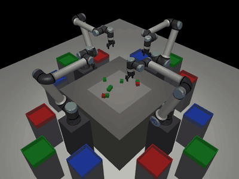

# Four-arm UR10e sorting cell with dRRT\* (MuJoCo)

**English** | [Tiếng Việt](README.vi.md)

Four UR10e arms with Robotiq 2F-85 grippers sort colored cubes on one shared table without collisions. An overhead RGB-D
camera finds the cubes, a cost-based allocator assigns cubes to arms, a multi-arm dRRT\* planner replans the moving arms
whenever an event occurs, and each arm picks its cube and drops it into the tray of matching color. The dRRT\* planner is
my own reimplementation of the paper.



## Main results

50 fixed scenes per set (seeded), poses estimated from the camera (the controller never reads simulator ground truth),
collisions counted at every `mj_step`.

| Scene set | Cubes sorted correctly | Collisions | Cubes / min |
| --- | --- | --- | --- |
| Standard (8 separated cubes) | 400/400 | 0 | 7.05 |
| Touching cubes, incl. same-color cubes merged in the image | 374/400 (99.2% of the cubes that are graspable at all) | 0 | 6.31 |
| 4 extra cubes dropped in while the cell runs | 600/600 | 0 | 7.49 |

- Arms work asynchronously with event-driven replanning: 30% higher throughput than moving all arms in lockstep rounds.
- Classical perception (HSV + depth, geometric splitting of touching cubes, sub-pixel edge fit): about 1 mm and 2° pose error.
- Cubes locked in 2 × 2 or triangular clusters cannot be grasped without pushing (each finger needs about 4 cm of free
  space); the cell detects them and leaves them instead of crashing into them.
- Ablations: turning off cube splitting or neighbour-aware grasp selection causes tens of thousands of collision steps.

Details, demos and how to reproduce: [sorting_cell/](sorting_cell/). Design, every measurement and the decision log
(including bugs found and how they were fixed): [docs/sorting_cell_plan.md](docs/sorting_cell_plan.md). Literature
review: [docs/research/](docs/research/). Most project documents are in Vietnamese.

## Quick start

```bash
uv venv -p 3.12 .venv
uv pip install --python .venv/bin/python -e . -e "sorting_cell[dev,video]"
cd sorting_cell
../.venv/bin/python -m pytest -q                       # sorting-cell tests
../.venv/bin/python -m sortcell.demo clusters          # opens a MuJoCo window; also: basic / arrivals
```

The first run builds roadmaps and cost tables (a few minutes); later runs load them from a cache.

## How it works

| Stage | Method |
| --- | --- |
| Perception | Overhead 640×480 RGB-D; HSV masks restricted to the cube-top height band; touching same-color cubes split by fitting 50 mm squares; pose refined by least squares on boundary pixels; tracker with occlusion handling |
| Task allocation | Greedy online assignment using precomputed roadmap travel costs (cube + tray) with a conflict penalty; CP-SAT offline reference |
| Motion planning | dRRT\* over per-arm PRM roadmaps; only moving arms are planned, arms doing a local pick/place are fixed obstacles whose reserved region is their whole descent sweep; carried cube modelled as a phantom box; 1 s planning budget |
| Execution | Scripted pick/place with neighbour-aware grasp direction and ordering constraints; gripper-sensor lift check; MuJoCo physics with contact-level collision counting |

## Repository layout

```
sorting_cell/  the sorting cell: perception, allocation, coordination, demo, experiments, results
src/drrt/      dRRT / ao-dRRT / dRRT* planners and the MuJoCo bridge (shared)
experiments/   planner experiments (2D disk robots from the paper, UR10e cells)
results/       planner data, figures, videos
tests/         planner tests, incl. a check that dRRT* converges to the A* optimum
docs/          sorting-cell plan and decision log, paper notes, planner results, literature review
third_party/   UR10e model from MuJoCo Menagerie (original license kept)
```

## The planner: dRRT\* reimplemented from the paper

Reimplementation of dRRT, ao-dRRT and dRRT\* from Shome et al., *"dRRT\*: Scalable and Informed Asymptotically-Optimal
Multi-Robot Motion Planning"* ([arXiv:1903.00994](https://arxiv.org/abs/1903.00994)), then applied to multiple UR10e arms in MuJoCo.


| Experiment | Result |
| --- | --- |
| 2 disk robots in 2D | dRRT\* cost converges to the A\* optimum on the same tensor roadmap for 10/10 roadmap pairs (Theorem 2) |
| 3 to 10 disk robots | dRRT\* solves 10/10 runs at every robot count; RRT\* in the composite space 0/10 from 5 robots ([figure](results/disks_many_robots/fig11.png)) |
| 4 UR10e arms (24 DoF) | dRRT\* finds a solution in under 25 ms; A\* on the same roadmap and RRT\* both 0/3 within 120 s |

```bash
.venv/bin/python -m pytest -q                                                          # about 2–3 minutes
MUJOCO_GL=egl .venv/bin/python experiments/ur10e_cells.py --task swap2 --skip-benchmark  # demo video in results/ur10e_swap/
```

`--task` accepts `crossing2` (two arms cross past a column), `swap2` (two arms swap places) or `rotate4` (four arms).

| Paper | Code |
| --- | --- |
| Per-robot PRM\* (Sec. 4.1), radius r\*(n) (Theorem 1) | [roadmap.py](src/drrt/roadmap.py) |
| Implicit tensor roadmap Ĝ, Adj(V), cost, heuristic H | [tensor_graph.py](src/drrt/tensor_graph.py) |
| Tree, rewiring, Adj(V) ∩ T | [tree.py](src/drrt/tree.py) |
| Shared loop of Alg. 1, 3, 6 | [planners/base.py](src/drrt/planners/base.py) |
| dRRT (Alg. 2, 5) and ao-dRRT (Alg. 4) | [planners/drrt.py](src/drrt/planners/drrt.py) |
| dRRT\* (Alg. 7, 8); comments numbered by Alg. 7 lines | [planners/drrt_star.py](src/drrt/planners/drrt_star.py) |
| Baselines: implicit A\*, RRT\* and PRM\* in the composite space (Sec. 8) | [planners/](src/drrt/planners/) |
| 2D disk robots (Sec. 8.1) | [checkers/disk2d.py](src/drrt/checkers/disk2d.py) |
| UR10e cell; collision split: offline per arm vs environment, online only between arms | [mujoco_cell.py](src/drrt/mujoco_cell.py) |
| Execution with `mj_step`, real collision checks, video | [execute.py](src/drrt/execute.py) |

Paper notes and comparisons with the paper's experiments (Vietnamese): [docs/paper_notes.md](docs/paper_notes.md),
[docs/results_disks_two_robots.md](docs/results_disks_two_robots.md),
[docs/results_disks_many_robots.md](docs/results_disks_many_robots.md), [docs/results_ur10e.md](docs/results_ur10e.md).

## Known limitations

- Simulation only; camera and robot parameters are exact.
- Clustered cubes that need pushing are left on the table (pick-only cell). Push-then-grasp is the planned next step.
- Arms stop at every path vertex and at each replanning event (no replanning from moving states yet).
- Replanning latency is about 0.55 s median, slower than recent GPU or swept-volume planners.
