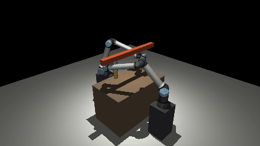

# dRRT\* trên MuJoCo

Implement lại dRRT, ao-dRRT và dRRT\* của Shome et al., *"dRRT\*: Scalable and Informed Asymptotically-Optimal Multi-Robot Motion
Planning"* ([arXiv:1903.00994](https://arxiv.org/abs/1903.00994)), rồi chạy cho nhiều tay UR10e trong MuJoCo.



## Kết quả chính

| Thí nghiệm | Kết quả |
| --- | --- |
| 2 robot đĩa 2D | Cost của dRRT\* hội tụ đúng về tối ưu của A\* trên cùng roadmap tensor, ở 10/10 cặp roadmap (Theorem 2) |
| 3 đến 10 robot đĩa | dRRT\* giải được 10/10 lần ở mọi số robot; RRT\* trên không gian gộp 0/10 từ 5 robot ([hình](results/disks_many_robots/fig11.png)) |
| 4 tay UR10e (24 chiều) | dRRT\* có lời giải sau dưới 25 ms; A\* trên cùng roadmap và RRT\* đều 0/3 trong 120 s |

Chi tiết, kể cả các chỗ không khớp với paper: [docs/](docs/).

## Chạy

```bash
uv venv -p 3.12 .venv
uv pip install --python .venv/bin/python -e ".[dev,video]"
.venv/bin/python -m pytest -q                                                          # khoảng 2–3 phút
MUJOCO_GL=egl .venv/bin/python experiments/ur10e_cells.py --task swap2 --skip-benchmark  # demo, ghi video vào results/ur10e_swap/
```

`--task` nhận `crossing2` (2 tay đi chéo qua cột), `swap2` (2 tay đổi chỗ) hoặc `rotate4` (4 tay).

## Paper ↔ code

| Paper | Code |
| --- | --- |
| PRM\* của từng robot (Mục 4.1), bán kính r\*(n) (Theorem 1) | [roadmap.py](src/drrt/roadmap.py) |
| Roadmap tensor Ĝ ngầm, Adj(V), hàm chi phí, heuristic H | [tensor_graph.py](src/drrt/tensor_graph.py) |
| Cây, rewire, phép tính Adj(V) ∩ T | [tree.py](src/drrt/tree.py) |
| Vòng lặp chung của Alg. 1, 3, 6 | [planners/base.py](src/drrt/planners/base.py) |
| dRRT (Alg. 2, 5) và ao-dRRT (Alg. 4) | [planners/drrt.py](src/drrt/planners/drrt.py) |
| dRRT\* (Alg. 7, 8); comment đánh số dòng theo Alg. 7 | [planners/drrt_star.py](src/drrt/planners/drrt_star.py) |
| Baseline: Implicit A\*, RRT\* và PRM\* trên không gian gộp (Mục 8) | [planners/](src/drrt/planners/) |
| Robot đĩa 2D (Mục 8.1) | [checkers/disk2d.py](src/drrt/checkers/disk2d.py) |

Ngoài paper, cho MuJoCo:

| Phần | Code |
| --- | --- |
| Cell UR10e; tách va chạm: offline từng tay với môi trường, online chỉ giữa các tay | [mujoco_cell.py](src/drrt/mujoco_cell.py) |
| Tác vụ, IK cho start/goal, cache roadmap | [cell_tasks.py](src/drrt/cell_tasks.py), [ik.py](src/drrt/ik.py) |
| Chạy đường đi bằng `mj_step`, kiểm tra va chạm thật, ghi video | [execute.py](src/drrt/execute.py) |

## Tài liệu

- [docs/paper_notes.md](docs/paper_notes.md): tóm tắt paper và các chỗ paper không viết rõ, kèm cách code xử lý.
- [docs/results_disks_two_robots.md](docs/results_disks_two_robots.md), [docs/results_disks_many_robots.md](docs/results_disks_many_robots.md): đối chiếu với thí nghiệm của paper.
- [docs/results_ur10e.md](docs/results_ur10e.md): cell UR10e trong MuJoCo.

## Thư mục

```
src/drrt/      planner và cầu nối MuJoCo
experiments/   script chạy thí nghiệm (disks_* theo paper, ur10e_* trên MuJoCo)
results/       số liệu, hình, video
tests/         test, gồm kiểm tra dRRT* hội tụ đúng về tối ưu của A*
third_party/   model UR10e từ MuJoCo Menagerie (giữ license gốc)
```
