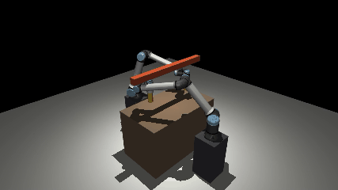

# Cell phân loại 4 tay UR10e với dRRT\* (MuJoCo)

Bốn tay UR10e gắn gripper Robotiq 2F-85 cùng phân loại khối màu trên một bàn chung, không va chạm. Camera RGB-D trên cao
tìm khối, bộ phân việc chia khối cho các tay theo chi phí, planner dRRT\* lập kế hoạch lại cho các tay đang di chuyển mỗi
khi có sự kiện, và mỗi tay gắp khối rồi bỏ vào khay đúng màu. Planner dRRT\* do repo này tự implement lại từ paper.


## Kết quả chính

50 cảnh cố định theo seed cho mỗi bộ, pose lấy từ camera (không dùng pose thật của sim), đếm va chạm ở từng bước `mj_step`.

| Bộ cảnh | Khối vào đúng khay | Va chạm | Khối/phút |
| --- | --- | --- | --- |
| Cảnh thường (8 khối rời) | 400/400 | 0 | 7,05 |
| Khối sát nhau, cùng màu dính nhau | 374/400 (99,2% số khối gắp được về nguyên tắc) | 0 | 6,31 |
| Thả thêm 4 khối giữa chừng | 600/600 | 0 | 7,49 |

- Các tay làm lệch giờ, lập kế hoạch lại theo sự kiện: nhanh hơn 30% so với để mọi tay đi theo lượt.
- Perception cổ điển (HSV + depth, tách khối dính nhau bằng hình học, khớp pose theo biên): sai số khoảng 1 mm và 2°.
- Khối nằm trong cụm 2 × 2 hay tam giác không gắp được nếu không đẩy (ngón gripper cần khoảng 4 cm trống); cell nhận ra
  và bỏ qua thay vì đâm vào.
- Tắt bước tách khối hoặc bước chọn hướng kẹp theo khối hàng xóm: hàng chục nghìn bước va chạm.

Chi tiết, demo và cách chạy lại: [sorting_cell/](sorting_cell/). Thiết kế, mọi số liệu, nhật ký quyết định (kể cả lỗi đã
gặp và cách sửa): [docs/sorting_cell_plan.md](docs/sorting_cell_plan.md). Rà soát tài liệu liên quan:
[docs/research/](docs/research/).

## Chạy thử

```bash
uv venv -p 3.12 .venv
uv pip install --python .venv/bin/python -e . -e "sorting_cell[dev,video]"
cd sorting_cell
../.venv/bin/python -m pytest -q                       # test của cell phân loại
../.venv/bin/python -m sortcell.demo clusters          # mở cửa sổ MuJoCo; hoặc basic / arrivals
```

Lần chạy đầu dựng roadmap và bảng chi phí (vài phút), các lần sau đọc từ cache.

## Thư mục

```
sorting_cell/  cell phân loại: perception, phân việc, điều phối, demo, thí nghiệm, kết quả
src/drrt/      planner dRRT / ao-dRRT / dRRT* và cầu nối MuJoCo (dùng chung)
experiments/   thí nghiệm của planner (robot đĩa theo paper, cell UR10e)
results/       số liệu, hình, video của planner
tests/         test của planner, gồm kiểm tra dRRT* hội tụ đúng về tối ưu của A*
docs/          kế hoạch và nhật ký của cell, ghi chú paper, kết quả planner, rà soát tài liệu
third_party/   model UR10e từ MuJoCo Menagerie (giữ license gốc)
```

## Planner: dRRT\* implement lại từ paper

Implement lại dRRT, ao-dRRT và dRRT\* của Shome et al., *"dRRT\*: Scalable and Informed Asymptotically-Optimal
Multi-Robot Motion Planning"* ([arXiv:1903.00994](https://arxiv.org/abs/1903.00994)), rồi chạy cho nhiều tay UR10e trong MuJoCo.



| Thí nghiệm | Kết quả |
| --- | --- |
| 2 robot đĩa 2D | Cost của dRRT\* hội tụ đúng về tối ưu của A\* trên cùng roadmap tensor, ở 10/10 cặp roadmap (Theorem 2) |
| 3 đến 10 robot đĩa | dRRT\* giải được 10/10 lần ở mọi số robot; RRT\* trên không gian gộp 0/10 từ 5 robot ([hình](results/disks_many_robots/fig11.png)) |
| 4 tay UR10e (24 chiều) | dRRT\* có lời giải sau dưới 25 ms; A\* trên cùng roadmap và RRT\* đều 0/3 trong 120 s |

```bash
.venv/bin/python -m pytest -q                                                          # khoảng 2–3 phút
MUJOCO_GL=egl .venv/bin/python experiments/ur10e_cells.py --task swap2 --skip-benchmark  # demo, ghi video vào results/ur10e_swap/
```

`--task` nhận `crossing2` (2 tay đi chéo qua cột), `swap2` (2 tay đổi chỗ) hoặc `rotate4` (4 tay).

### Paper ↔ code

| Paper | Code |
| --- | --- |
| PRM\* của từng robot (Mục 4.1), bán kính r\*(n) (Theorem 1) | [roadmap.py](src/drrt/roadmap.py) |
| Roadmap tensor Ĝ ngầm, Adj(V), hàm chi phí, heuristic H | [tensor_graph.py](src/drrt/tensor_graph.py) |
| Cây, rewire, phép tính Adj(V) ∩ T | [tree.py](src/drrt/tree.py) |
| Vòng lặp chung của Alg. 1, 3, 6 | [planners/base.py](src/drrt/planners/base.py) |
| dRRT (Alg. 2, 5) và ao-dRRT (Alg. 4) | [planners/drrt.py](src/drrt/planners/drrt.py) |
| dRRT\* (Alg. 7, 8); comment đánh số dòng theo Alg. 7 | [planners/drrt_star.py](src/drrt/planners/drrt_star.py) |
| Baseline: Implicit A\*, RRT\* và PRM\* trên không gian gộp (Mục 8) | [planners/](src/drrt/planners/) |
| Robot đĩa 2D (Mục 8.1) | [checkers/disk2d.py](src/drrt/checkers/disk2d.py) |

Ngoài paper, cho MuJoCo:

| Phần | Code |
| --- | --- |
| Cell UR10e; tách va chạm: offline từng tay với môi trường, online chỉ giữa các tay | [mujoco_cell.py](src/drrt/mujoco_cell.py) |
| Tác vụ, IK cho start/goal, cache roadmap | [cell_tasks.py](src/drrt/cell_tasks.py), [ik.py](src/drrt/ik.py) |
| Chạy đường đi bằng `mj_step`, kiểm tra va chạm thật, ghi video | [execute.py](src/drrt/execute.py) |

### Tài liệu của planner

- [docs/paper_notes.md](docs/paper_notes.md): tóm tắt paper và các chỗ paper không viết rõ, kèm cách code xử lý.
- [docs/results_disks_two_robots.md](docs/results_disks_two_robots.md), [docs/results_disks_many_robots.md](docs/results_disks_many_robots.md): đối chiếu với thí nghiệm của paper.
- [docs/results_ur10e.md](docs/results_ur10e.md): cell UR10e trong MuJoCo.
